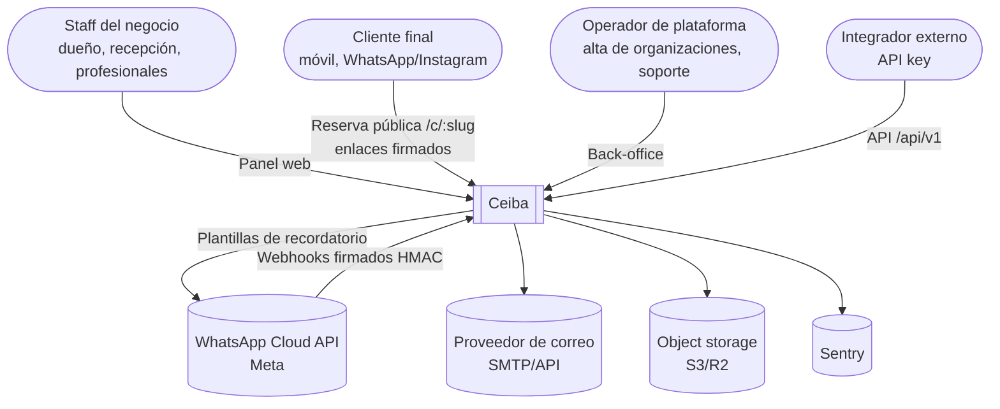
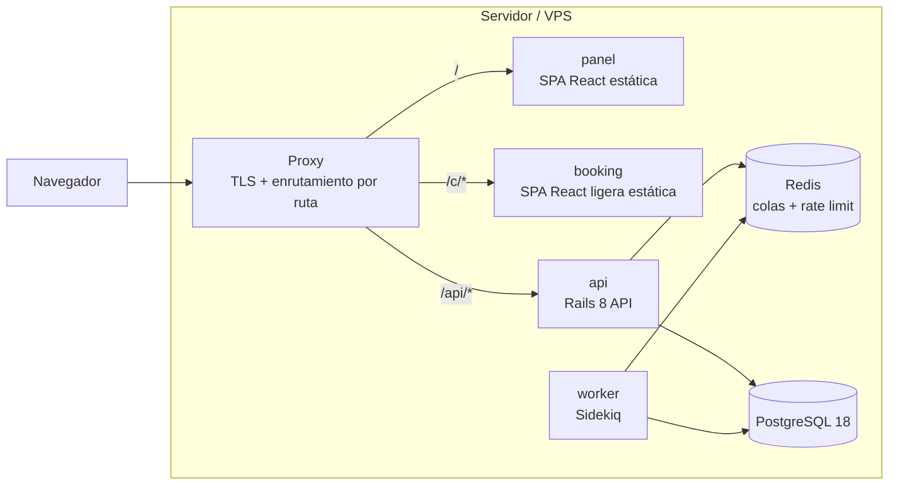

# 01 — Vista general

> Mapa de alto nivel. Cada sección enlaza al documento que la desarrolla.

## Contexto (C4 nivel 1)



## Contenedores (C4 nivel 2)



| Contenedor | Responsabilidad | Documento |
| --- | --- | --- |
| Proxy | TLS y enrutamiento por ruta en **un solo origen** | [10](10-infrastructure.md) |
| `panel` | SPA del staff; módulos cargados según `/api/v1/me` | [08](08-frontend.md) |
| `booking` | Reserva pública mobile-first, con presupuesto de JS < 150 KB | [08](08-frontend.md) |
| `api` | Rails 8 en modo API; monolito modular con packs | [02](02-modular-monolith.md) |
| `worker` | Sidekiq: relay del outbox, consumidores de eventos, notificaciones, escáneres periódicos | [06](06-events-and-jobs.md) |
| Redis | Colas de Sidekiq y store de Rack::Attack (namespaces separados) | [06](06-events-and-jobs.md), [11](11-security.md) |
| PostgreSQL 18 | Fuente de verdad; invariantes como restricciones; RLS | [03](03-multi-tenancy.md), [09](09-data-conventions.md) |

## Stack

| Capa | Elección | Motivo principal |
| --- | --- | --- |
| Backend | Ruby on Rails 8 (API) | Productividad, ecosistema y experiencia del equipo |
| Base de datos | PostgreSQL 18 | Exclusion constraints, RLS, DDL transaccional, `uuidv7()` ([ADR-0002](../adr/0002-postgresql-18.md)) |
| Modularidad | Packwerk + packwerk-extensions | Límites entre módulos verificados en CI ([ADR-0001](../adr/0001-monolito-modular-packwerk.md)) |
| Jobs | Sidekiq + Redis | Madurez y panel; con outbox propio ([ADR-0009](../adr/0009-sidekiq-con-outbox.md)) |
| Autorización | Pundit, consultando permisos como datos | Una policy por pack ([ADR-0007](../adr/0007-pundit-sobre-cancancan.md), [ADR-0008](../adr/0008-permisos-como-datos.md)) |
| Frontend | React + TypeScript + Vite, TanStack Query | Estándar, tipado, caché de servidor |
| UI | Tailwind + shadcn/ui con tokens CSS | Componentes propios y branding por empresa |
| Agenda | Librería gratuita detrás de `AgendaView` | Evitar la licencia Premium de FullCalendar ([ADR-0014](../adr/0014-calendario-gratuito-con-adaptador.md)) |
| Contrato API | OpenAPI (rswag) → cliente TS generado | API-first sin desincronización ([ADR-0012](../adr/0012-contrato-openapi-y-cliente-generado.md)) |
| Despliegue | Docker + Kamal 2 en VPS | Sin Kubernetes; un solo comando |
| Observabilidad | Sentry + logs JSON + health/ready | Mínimo suficiente |

## Estructura del repositorio

```
backend/
  app/                     solo lo transversal de Rails (ApplicationController, ApplicationRecord…)
  packs/
    platform/
      identity/  tenancy/  access/  modules/  events/  audit/  notifications/  customers/
    modules/
      appointments/
  spec/support/            harness compartidos (aislamiento de tenant, matriz de autorización)
frontend/
  apps/panel/  apps/booking/
  packages/ui/  packages/api-client/  packages/branding/
infra/
  docker/  proxy/  kamal/  backup/
docs/
```

## Flujo típico de una request autenticada

1. **Proxy** → `api` (`/api/v1/...`).
2. **Rack::Attack**: límites por IP, slug o cuenta, antes de tocar la BD ([11](11-security.md)).
3. **Autenticación**: cookie de sesión o API key → `Principal` ([04](04-access-control.md)).
4. **Contexto**: se resuelven organización, empresa y sucursal desde la ruta y se validan contra el principal → `Tenancy.with_context` fija el tenant y `SET LOCAL app.organization_id` ([03](03-multi-tenancy.md)).
5. **Módulo activo**: si el endpoint pertenece a un módulo desactivado para la empresa → `404` ([05](05-module-system.md)).
6. **Autorización**: Pundit consulta permisos efectivos (`authorize`, `policy_scope`).
7. **Dominio**: servicio del pack; los cambios y sus eventos se escriben en **una sola transacción** (outbox) y se registra la auditoría.
8. **Respuesta**: serializer Alba, o un error `application/problem+json` ([07](07-api-contract.md)).
