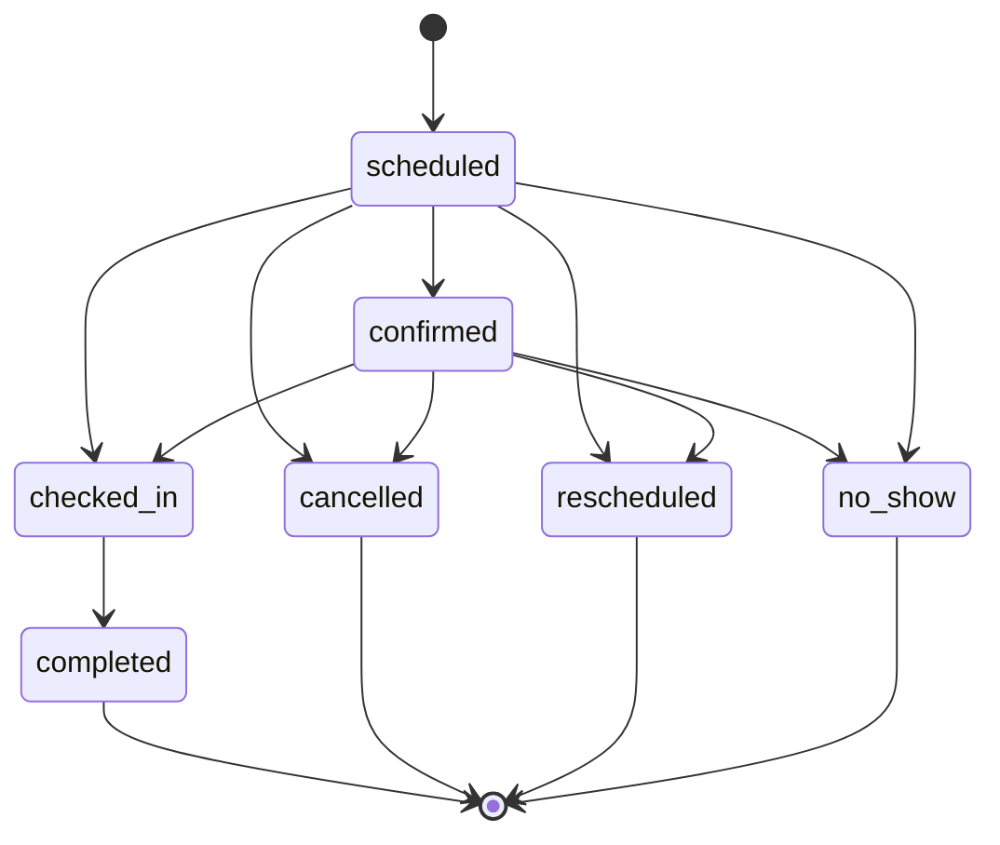

# Dominio: módulo de citas (`appointments`)

> Migrado desde `plans/plan-ecosistema-modular-modulo-citas.md` §4–§5 y Fase 1. Decisiones: [ADR-0018](../adr/0018-integridad-de-agenda-en-bd.md), [ADR-0019](../adr/0019-reprogramar-crea-cita-nueva.md), [ADR-0020](../adr/0020-persona-separada-de-profesional.md), [ADR-0029](../adr/0029-citas-multi-servicio.md), [ADR-0034](../adr/0034-horarios-ausencias-y-permisos-de-profesionales-y-recursos.md). Hitos: F1–F3.

## Alcance del MVP

**Incluye:** catálogo de servicios; profesionales y recursos con horarios, descansos y ausencias; agenda del staff; página pública `/c/:slug`; recordatorios por correo y WhatsApp; cancelación y reprogramación por el cliente.

**Excluye:** pagos y depósitos, facturación, inventario, historial clínico, sincronización con calendarios externos, citas recurrentes, capacidad mayor a uno por franja (clases), lista de espera (P2), duración variable (P2).

## Modelo

```
services                      (empresa)
  id, organization_id, company_id, name, duration_minutes, buffer_before_minutes, buffer_after_minutes,
  price_minor, currency, active, position, archived_at, created_at, updated_at
branch_service_overrides      (sucursal: solo duración y/o precio)
  id, organization_id, company_id, branch_id, service_id, duration_minutes NULL, price_minor NULL,
  created_at, updated_at                              -- UNIQUE(branch_id, service_id); al menos un valor no nulo

professionals                 (empresa)
  id, organization_id, company_id, user_id NULL, display_name, active, archived_at, created_at, updated_at
                                                      -- UNIQUE parcial (company_id, user_id) WHERE user_id IS NOT NULL
professional_branch_assignments
  id, organization_id, company_id, professional_id, branch_id, created_at, updated_at
                                                      -- FKs triples a professionals y branches; UNIQUE(professional_id, branch_id)
professional_services         (qué servicios presta)
  id, organization_id, company_id, professional_id, service_id, created_at, updated_at

resources                     (sucursal)
  id, organization_id, company_id, branch_id, name, kind ('chair'|'room'|'equipment'), active, archived_at,
  created_at, updated_at
service_resource_requirements (qué TIPO de recurso necesita un servicio)
  id, organization_id, company_id, service_id, kind, created_at, updated_at   -- UNIQUE(service_id, kind)

weekly_schedules              (horario semanal local)
  id, organization_id, company_id, branch_id, owner_type ('branch'|'professional'|'resource'),
  professional_id NULL, resource_id NULL, weekday (0-6, 0 = domingo), starts_at_local (time), ends_at_local (time),
  created_at, updated_at
time_offs
  id, organization_id, company_id, owner_type ('professional'|'resource'), professional_id NULL, resource_id NULL,
  starts_at (timestamptz), ends_at, reason NULL (texto libre, hasta 200, sin datos de salud), created_at, updated_at

appointments
  id, organization_id, company_id, branch_id, customer_id, professional_id, resource_id NULL,
  starts_at, ends_at, blocks_from, blocks_to,          -- blocks_* incluye buffers (snapshot)
  status, source, rescheduled_from_id NULL, notes, lock_version, created_by (actor), timestamps
appointment_services
  appointment_id, service_id, position, duration_minutes, buffer_before, buffer_after, price_minor, currency
```

Todas son tablas tenant (`create_tenant_table`) con FKs compuestas hacia sus padres.

### Cómo quedó implementado (M1.02)

- **Dueño explícito, no polimórfico.** `weekly_schedules` y `time_offs` llevan `professional_id` y `resource_id` anulables más `owner_type`, con un CHECK de coherencia (solo la columna del tipo de dueño está llena) y una clave foránea compuesta por columna: un horario de profesional exige una asignación a esa sucursal `(organization_id, company_id, professional_id, branch_id)` y uno de recurso exige que el recurso sea de esa sucursal. Un `owner_id` polimórfico no admite FK ([ADR-0034](../adr/0034-horarios-ausencias-y-permisos-de-profesionales-y-recursos.md)).
- **Requisitos por `kind`.** `service_resource_requirements` pide un tipo de recurso (`chair`, `room`, `equipment`) y no un recurso concreto: el motor exige un recurso compatible libre en la sucursal ([M1.04](../milestones/F1-citas-dominio/M1.04-disponibilidad-completa.md)).
- **Franjas de minuto entero y sin cruzar la medianoche.** CHECKs: `weekday` entre 0 y 6, `starts_at_local < ends_at_local` y precisión de minuto (sin ella, una franja de menos de un minuto da un rango vacío y escapa a la exclusión).
- **Sin solapes, garantizado por la BD.** Tres exclusion constraints parciales sobre `int4range` de minutos del día, semiabierto `[)` (9–13 y 13–15 no solapan): por sucursal (`owner_type = 'branch'`), por profesional (en **todas** sus sucursales: una persona no está en dos sitios a la vez) y por recurso. El modelo da el mismo error como `slots: overlap` (`422`) antes de llegar a la BD.
- **El `PUT` del horario reemplaza todas las franjas del dueño en esa sucursal** en una transacción, serializada por dueño con un candado consultivo.
- **Ausencias solapadas del mismo dueño se permiten**: el motor resta la unión.
- **Sucursal sin horario = cerrada.** `on_enable` del módulo (`Appointments::Lifecycle::OnEnable`) da lunes a sábado de 08:00 a 18:00 a las sucursales que existen **al activar** y que no tienen horario; una sucursal creada después empieza sin horario (cerrada para el motor) hasta que el gerente lo configura (M2.01).

### Cómo quedó implementado (M1.03)

- **Núcleo puro y cargador de consultas fijas.** `Appointments::Availability::{Interval, IntervalSet, WeeklyExpander, SlotFinder, Calculator}` no usan ActiveRecord (intervalos UTC semiabiertos); `DataLoader` es lo único que consulta y emite un número fijo de consultas, sea cual sea el rango. `Availability.call` devuelve un `Result` con `slots`, `duration_minutes` y `step_minutes` ([ADR-0035](../adr/0035-motor-de-disponibilidad-caso-base.md)).
- **Agenda única por persona.** Las citas y ausencias del profesional restan en **todas** sus sucursales; las franjas semanales, solo las de la sucursal pedida. Quien consulta ve libre/ocupado, nunca el detalle de otra sucursal.
- **Hora local a UTC en un solo lugar** (`WeeklyExpander`): una hora inexistente se recorta a la transición, una ambigua toma su primera ocurrencia y la contención es cronológica. No se usa `TimeZone#local`.
- **Rejilla del reloj local:** un inicio es válido si su minuto del día local es múltiplo de `slot_step_minutes`. `min_lead_time_minutes` y `max_advance_days` (`now + N × 24 h`) se miden desde `now`.
- **`appointments` mínima:** `status` (por defecto `scheduled`) y las columnas que lee el motor (`company_id`, `branch_id`, `professional_id`, `starts_at`, `ends_at`, `blocks_from`, `blocks_to`), con claves foráneas compuestas y sin constraints de agenda. M1.05 añade `customer_id`, `resource_id`, `source`, `notes`, `lock_version`, `created_by` y `rescheduled_from_id` junto con las constraints. `Appointment.blocking` excluye `cancelled` y `rescheduled`; `Appointment.overlapping` usa `blocks_*` y es semiabierto.
- **Endpoint** `GET …/appointments/branches/:branch_id/availability?service_id&professional_id&from&to` con el permiso `appointments.appointment.create` a alcance de sucursal; rango de hasta 31 días; errores `400` (`request.invalid`, `request.bad_request`, también para un parámetro repetido), `403`, `404` y `422 appointments.availability_invalid`.
- **Una sucursal inactiva está cerrada:** `ensure_eligible!` responde `422` con `branch_id` `inactive`. También se rechaza un `from` anterior a ayer en la hora local de la sucursal (`from` `too_early`) y, para los llamadores que no pasan por el controlador, un registro de otra empresa (`wrong_company`).
- **Aislamiento por empresa:** las consultas del cargador filtran por `company_id` además de por organización. Los límites inferiores se redondean hacia arriba al segundo, así que un hueco no invade por una fracción una ausencia que termina en `hh:mm:ss.5`.

### Cómo quedó implementado (M1.04)

- **Varios servicios:** duración = Σ duraciones con override; bloque = buffer previo del primero + duración + buffer posterior del último, y el bloque entero cabe en el horario; precio = Σ precios con override, en la moneda de la empresa ([ADR-0036](../adr/0036-motor-de-disponibilidad-completo-y-superficie-publica.md)).
- **`:any`:** elegibles = asignados a la sucursal, activos y que prestan todos los servicios; para cada inicio gana el de menos citas que bloquean ese día local (en todas sus sucursales), con desempate por `id`.
- **Recursos:** un solo tipo por petición (`multiple_resource_kinds` si se piden más); el recurso libre de menor `id`; un recurso sin franjas sigue el horario de la sucursal. `appointments.resource_id` existe desde este hito (sin `no_overlap_resource`, que llega con `Book`).
- **Superficie pública** `GET /api/public/v1/c/:slug/availability`: sin datos personales, `404` uniforme, hasta 14 días, caché de 30 s y regla 5 de Rack::Attack.

## Restricciones críticas

```sql
CREATE EXTENSION IF NOT EXISTS btree_gist;

ALTER TABLE appointments ADD CONSTRAINT no_overlap_professional
  EXCLUDE USING gist (professional_id WITH =, tstzrange(blocks_from, blocks_to) WITH &&)
  WHERE (status NOT IN ('cancelled', 'rescheduled'));

ALTER TABLE appointments ADD CONSTRAINT no_overlap_resource
  EXCLUDE USING gist (resource_id WITH =, tstzrange(blocks_from, blocks_to) WITH &&)
  WHERE (resource_id IS NOT NULL AND status NOT IN ('cancelled', 'rescheduled'));

ALTER TABLE appointments ADD CONSTRAINT valid_interval
  CHECK (starts_at < ends_at AND blocks_from <= starts_at AND blocks_to >= ends_at);
```

> `no_show` y `completed` siguen bloqueando su intervalo: el tiempo ya ocurrió. Solo `cancelled` y `rescheduled` lo liberan.

## Estados



- Transiciones en `Appointments::Transitions` (tabla de transiciones válidas y su permiso requerido). Ningún controlador actualiza `status` directamente.
- Cada transición: bloqueo de la fila, `UPDATE … WHERE status IN (<origen válido>)` verificando las filas afectadas, auditoría y evento en el outbox, todo en **una** transacción.
- `no_show` solo se permite después de `starts_at`; `completed`, después de `checked_in`.

## Casos de uso (API pública del pack)

| Servicio | Responsabilidad |
| --- | --- |
| `Appointments::Availability.call(company:, branch:, services:, professional:, from_date:, to_date:, now:)` (`professional` es un profesional o `:any`) | Devuelve un `Result(slots:, duration_minutes:, buffer_before_minutes:, buffer_after_minutes:, price_minor:, currency:, step_minutes:)`; cada hueco es `Slot(starts_at, ends_at, professional_id, resource_id)` en UTC, con `ends_at = starts_at + duración` (sin buffers) |
| `Appointments::Book.call(context:, customer:, services:, professional:, starts_at:, source:, idempotency_key:)` | **Único** creador de citas. Calcula el snapshot, valida la persona entre empresas, inserta y traduce la violación de la constraint en `SlotUnavailable` |
| `Appointments::Reschedule.call(appointment:, starts_at:, professional:)` | Bloquea, marca `rescheduled` y llama a `Book` con `rescheduled_from_id` |
| `Appointments::Transition.call(appointment:, to:, actor:)` | Confirmar, check-in, completar, no-show, cancelar |

## Motor de disponibilidad

**Entrada:** empresa, sucursal, lista de servicios, profesional o `:any`, rango de fechas (en la zona de la sucursal).
**Salida:** huecos con duración y precio totalizados.

Algoritmo (por profesional elegible):

1. Servicios → duración = Σ duraciones (con override de sucursal); bloque = buffer previo del primero + duración + buffer posterior del último (los buffers son preparación y limpieza de la cita, no de cada servicio). El precio total = Σ precios (con override), en la moneda de la empresa.
2. Profesionales elegibles: asignados a la sucursal, activos y que prestan **todos** los servicios.
3. Ventanas abiertas = horario de la sucursal ∩ horario del profesional, convertido de hora local a UTC **día por día** (correcto ante DST).
4. Restar ausencias del profesional y citas que bloquean (`blocks_from/blocks_to`).
5. Si los servicios requieren un recurso: intersectar con la disponibilidad de algún recurso compatible.
6. Generar inicios cada `slot_step_minutes` (setting, por defecto 15) donde quepa la duración total.
7. Filtrar por anticipación mínima (`min_lead_time_minutes`, 120) y máxima (`max_advance_days`, 60).
8. `:any` → para cada inicio, el primer profesional libre según una política de reparto (por defecto: el de menor carga del día).

Implementación como objetos puros (sin ActiveRecord en el núcleo: recibe intervalos y devuelve intervalos), con un adaptador que carga los datos en pocas consultas. **El motor sugiere; la base decide.**

## Reglas de negocio

- Todo en UTC; la zona de la sucursal manda en la presentación y en la interpretación de horarios.
- La persona (usuario) no puede tener dos citas solapadas en ninguna empresa del grupo (validado en `Book` con `pg_advisory_xact_lock` sobre el `user_id`).
- La cancelación por el cliente respeta `cancellation_window_hours` (setting); fuera de la ventana, solo el staff puede cancelar.
- Las notas de la cita son operativas; **nunca datos clínicos**.

## Settings del módulo (JSON Schema)

| Clave | Default | Niveles |
| --- | --- | --- |
| `min_lead_time_minutes` | 120 | empresa, sucursal |
| `max_advance_days` | 60 | empresa, sucursal |
| `slot_step_minutes` | 15 | empresa, sucursal |
| `cancellation_window_hours` | 4 | empresa |
| `public_booking_enabled` | true | empresa, sucursal |
| `any_professional_policy` | `least_busy` | empresa |
| `reminders` | `[{ "kind": "24h", "offset_minutes": 1440 }, { "kind": "2h", "offset_minutes": 120 }]` | empresa |
