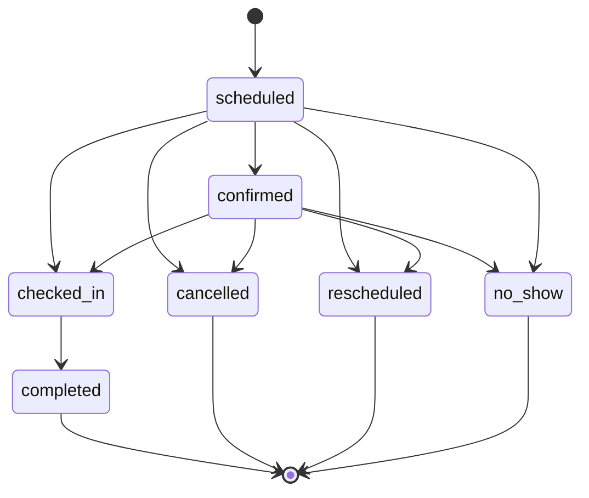

# Dominio: módulo de citas (`appointments`)

> Migrado desde `plans/plan-ecosistema-modular-modulo-citas.md` §4–§5 y Fase 1. Decisiones: [ADR-0018](../adr/0018-integridad-de-agenda-en-bd.md), [ADR-0019](../adr/0019-reprogramar-crea-cita-nueva.md), [ADR-0020](../adr/0020-persona-separada-de-profesional.md), [ADR-0029](../adr/0029-citas-multi-servicio.md). Hitos: F1–F3.

## Alcance del MVP

**Incluye:** catálogo de servicios; profesionales y recursos con horarios, descansos y ausencias; agenda del staff; página pública `/c/:slug`; recordatorios por correo y WhatsApp; cancelación y reprogramación por el cliente.

**Excluye:** pagos y depósitos, facturación, inventario, historial clínico, sincronización con calendarios externos, citas recurrentes, capacidad mayor a uno por franja (clases), lista de espera (P2), duración variable (P2).

## Modelo

```
services                      (empresa)
  id, organization_id, company_id, name, duration_minutes, buffer_before_minutes, buffer_after_minutes,
  price_minor, currency, active, archived_at, position
branch_service_overrides      (sucursal: solo duración y/o precio)
  branch_id, service_id, duration_minutes NULL, price_minor NULL

professionals                 (empresa)
  id, organization_id, company_id, user_id NULL, display_name, active, archived_at
professional_branch_assignments
  professional_id, branch_id
professional_services         (qué servicios presta)
  professional_id, service_id

resources                     (sucursal)
  id, organization_id, company_id, branch_id, name, kind ('chair'|'room'|'equipment'), active
service_resource_requirements (qué tipo/recurso requiere un servicio, opcional)

weekly_schedules              (horario semanal local)
  owner_type ('branch'|'professional'|'resource'), owner_id, branch_id, weekday (0-6),
  starts_at_local (time), ends_at_local (time)
time_offs
  owner_type, owner_id, starts_at (timestamptz), ends_at, reason

appointments
  id, organization_id, company_id, branch_id, customer_id, professional_id, resource_id NULL,
  starts_at, ends_at, blocks_from, blocks_to,          -- blocks_* incluye buffers (snapshot)
  status, source, rescheduled_from_id NULL, notes, lock_version, created_by (actor), timestamps
appointment_services
  appointment_id, service_id, position, duration_minutes, buffer_before, buffer_after, price_minor, currency
```

Todas son tablas tenant (`create_tenant_table`) con FKs compuestas hacia sus padres.

## Restricciones críticas

```sql
CREATE EXTENSION IF NOT EXISTS btree_gist;

ALTER TABLE appointments ADD CONSTRAINT no_overlap_professional
  EXCLUDE USING gist (professional_id WITH =, tstzrange(blocks_from, blocks_to) WITH &&)
  WHERE (status NOT IN ('cancelled', 'rescheduled'));

ALTER TABLE appointments ADD CONSTRAINT no_overlap_resource
  EXCLUDE USING gist (resource_id WITH =, tstzrange(blocks_from, blocks_to) WITH &&)
  WHERE (resource_id IS NOT NULL AND status NOT IN ('cancelled', 'rescheduled'));

ALTER TABLE appointments ADD CONSTRAINT valid_interval
  CHECK (starts_at < ends_at AND blocks_from <= starts_at AND blocks_to >= ends_at);
```

> `no_show` y `completed` siguen bloqueando su intervalo: el tiempo ya ocurrió. Solo `cancelled` y `rescheduled` lo liberan.

## Estados



- Transiciones en `Appointments::Transitions` (tabla de transiciones válidas y su permiso requerido). Ningún controlador actualiza `status` directamente.
- Cada transición: bloqueo de la fila, `UPDATE … WHERE status IN (<origen válido>)` verificando las filas afectadas, auditoría y evento en el outbox, todo en **una** transacción.
- `no_show` solo se permite después de `starts_at`; `completed`, después de `checked_in`.

## Casos de uso (API pública del pack)

| Servicio | Responsabilidad |
| --- | --- |
| `Appointments::Availability.call(company:, branch:, services:, professional: or :any, from:, to:)` | Devuelve huecos `[{ starts_at_utc, duration_minutes, price_minor, currency, professional_id }]` |
| `Appointments::Book.call(context:, customer:, services:, professional:, starts_at:, source:, idempotency_key:)` | **Único** creador de citas. Calcula el snapshot, valida la persona entre empresas, inserta y traduce la violación de la constraint en `SlotUnavailable` |
| `Appointments::Reschedule.call(appointment:, starts_at:, professional:)` | Bloquea, marca `rescheduled` y llama a `Book` con `rescheduled_from_id` |
| `Appointments::Transition.call(appointment:, to:, actor:)` | Confirmar, check-in, completar, no-show, cancelar |

## Motor de disponibilidad

**Entrada:** empresa, sucursal, lista de servicios, profesional o `:any`, rango de fechas (en la zona de la sucursal).
**Salida:** huecos con duración y precio totalizados.

Algoritmo (por profesional elegible):

1. Servicios → duración total = Σ duraciones (con override de sucursal) + buffer previo del primero + buffer posterior del último. El precio total = Σ precios (con override).
2. Profesionales elegibles: asignados a la sucursal, activos y que prestan **todos** los servicios.
3. Ventanas abiertas = horario de la sucursal ∩ horario del profesional, convertido de hora local a UTC **día por día** (correcto ante DST).
4. Restar ausencias del profesional y citas que bloquean (`blocks_from/blocks_to`).
5. Si los servicios requieren un recurso: intersectar con la disponibilidad de algún recurso compatible.
6. Generar inicios cada `slot_step_minutes` (setting, por defecto 15) donde quepa la duración total.
7. Filtrar por anticipación mínima (`min_lead_time_minutes`, 120) y máxima (`max_advance_days`, 60).
8. `:any` → para cada inicio, el primer profesional libre según una política de reparto (por defecto: el de menor carga del día).

Implementación como objetos puros (sin ActiveRecord en el núcleo: recibe intervalos y devuelve intervalos), con un adaptador que carga los datos en pocas consultas. **El motor sugiere; la base decide.**

## Reglas de negocio

- Todo en UTC; la zona de la sucursal manda en la presentación y en la interpretación de horarios.
- La persona (usuario) no puede tener dos citas solapadas en ninguna empresa del grupo (validado en `Book` con `pg_advisory_xact_lock` sobre el `user_id`).
- La cancelación por el cliente respeta `cancellation_window_hours` (setting); fuera de la ventana, solo el staff puede cancelar.
- Las notas de la cita son operativas; **nunca datos clínicos**.

## Settings del módulo (JSON Schema)

| Clave | Default | Niveles |
| --- | --- | --- |
| `min_lead_time_minutes` | 120 | empresa, sucursal |
| `max_advance_days` | 60 | empresa, sucursal |
| `slot_step_minutes` | 15 | empresa, sucursal |
| `cancellation_window_hours` | 4 | empresa |
| `public_booking_enabled` | true | empresa, sucursal |
| `any_professional_policy` | `least_busy` | empresa |
| `reminders` | `[{ "kind": "24h", "offset_minutes": 1440 }, { "kind": "2h", "offset_minutes": 120 }]` | empresa |
