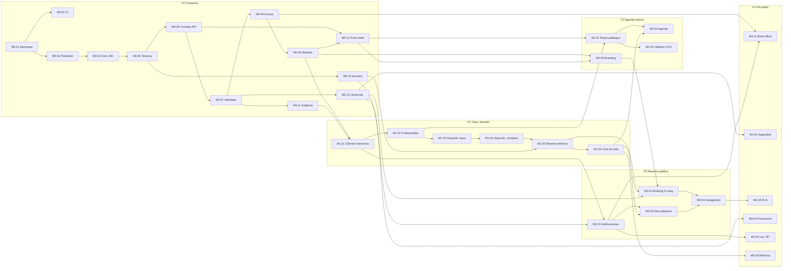

# Hoja de ruta

> Fuente única del **estado** del proyecto. Cada hito tiene su archivo en [`../milestones/`](../milestones/) con objetivo, contexto, alcance, criterios de aceptación y definición de terminado ([plantilla](../templates/milestone.md)).
> Ritmo de referencia: **8–15 h/semana** → un hito ≈ una semana. Ningún hito supera 15 h; si crece, se divide.

## Reglas de trabajo

1. **Un solo hito `en curso` a la vez.** Terminar antes de empezar. Lo que se descubra fuera del alcance se anota como hito o deuda; no se mete al hito actual.
2. **Una fase no empieza hasta que la anterior cumple su DoD**, salvo los hitos marcados como _adelantables_.
3. **TDD estricto:** cada criterio de aceptación nace como un test que falla.
4. **Toda decisión nueva genera un ADR** en [`../adr/`](../adr/); toda desviación del diseño actualiza [`../architecture/`](../architecture/).
5. Al cerrar un hito: marcarlo ✅ `terminado` aquí y en su archivo, y completar sus "Notas de cierre", **en el mismo PR del hito** y en cuanto esté completo en local (criterios de aceptación probados y `make ci` en verde), antes de mergear: el merge publica el cierre. Con `main` protegida, hacerlo después del merge exigiría otro PR solo para el estado.

## Resumen por fase

| Fase | Propósito | Hitos | Horas est. | Semanas aprox. | Resultado al cerrar |
| --- | --- | --- | --- | --- | --- |
| **F0 — Cimientos** | Plataforma multi-tenant y modular sin funcionalidad de negocio | 13 | ~143 | 12–14 | _Walking skeleton_: login, contexto org/empresa/sucursal, módulos activables, eventos, auditoría, API tipada y panel vacío pero real |
| **F1 — Citas: dominio** | Modelo de citas y motor de disponibilidad, solo backend | 6 | ~77 | 7 | Se puede reservar, reprogramar y cancelar vía API sin dobles reservas |
| **F2 — Agenda interna** | El staff opera su agenda desde el panel | 4 | ~52 | 5 | Piloto interno con datos de prueba |
| **F3 — Reserva pública** | Clientes reservan solos y reciben recordatorios | 4 | ~54 | 5 | Enlace `/c/:slug` compartible por WhatsApp/Instagram + recordatorios |
| **F4 — Pre-piloto** | Endurecer, desplegar y cumplir Ley 787 | 6 | ~74 | 6–7 | Producción y staging listos para 2–3 negocios reales |
| F5 — Pilotos | 2–3 negocios en Nicaragua, 3 meses | — | operativo | 12 | Uso diario medido, feedback priorizado |
| F6 — Producto vendible | Planes, entitlements y cobro | — | por definir | — | Primer cliente pagando |
| F7 — Segundo módulo | Validar el playbook de módulos de punta a punta | — | por definir | — | Un módulo nuevo sin tocar `platform/` (o con cambios justificados) |

**Total F0–F4: ~400 h, unos 8 meses al ritmo indicado.** Es una cifra honesta, no pesimista. F0 parece "lento" porque es donde se paga la extensibilidad; cada módulo futuro se apoya en ella sin rehacerla.

> F5–F7 se detallan en hitos **cuando F4 cierre**. Planificarlos hoy sería planificar sobre suposiciones que los pilotos van a corregir.

## Estado de los hitos

Leyenda: ⬜ pendiente · 🟦 en curso · 🟥 bloqueado · ✅ terminado

### F0 — Cimientos de plataforma

| Hito | Título | h | Depende de | Estado |
| --- | --- | --- | --- | --- |
| [M0.01](../milestones/F0-cimientos/M0.01-monorepo-y-entorno-docker.md) | Monorepo y entorno Docker | 10 | — | ✅ |
| [M0.02](../milestones/F0-cimientos/M0.02-ci-base.md) | CI base | 6 | [M0.01](../milestones/F0-cimientos/M0.01-monorepo-y-entorno-docker.md) | ✅ |
| [M0.03](../milestones/F0-cimientos/M0.03-packwerk-capas-y-generador.md) | Packwerk, capas y generador de packs | 8 | [M0.01](../milestones/F0-cimientos/M0.01-monorepo-y-entorno-docker.md) | ✅ |
| [M0.04](../milestones/F0-cimientos/M0.04-convenciones-de-base-de-datos.md) | Convenciones de base de datos (UUIDv7, tablas tenant, FKs compuestas) | 10 | [M0.03](../milestones/F0-cimientos/M0.03-packwerk-capas-y-generador.md) | ✅ |
| [M0.05](../milestones/F0-cimientos/M0.05-tenancy-base.md) | Tenancy base | 12 | [M0.04](../milestones/F0-cimientos/M0.04-convenciones-de-base-de-datos.md) | ✅ |
| [M0.06](../milestones/F0-cimientos/M0.06-contrato-api.md) | Contrato API (OpenAPI, errores, paginación, cliente TS) | 12 | [M0.05](../milestones/F0-cimientos/M0.05-tenancy-base.md) | ✅ |
| [M0.07](../milestones/F0-cimientos/M0.07-identidad-y-sesiones.md) | Identidad y sesiones | 14 | [M0.06](../milestones/F0-cimientos/M0.06-contrato-api.md) | ✅ |
| [M0.08](../milestones/F0-cimientos/M0.08-control-de-acceso.md) | Control de acceso (permisos como datos, principal, Pundit) | 14 | [M0.07](../milestones/F0-cimientos/M0.07-identidad-y-sesiones.md) | ✅ |
| [M0.09](../milestones/F0-cimientos/M0.09-sistema-de-modulos.md) | Sistema de módulos (manifiesto, activación, `/me`) | 12 | [M0.08](../milestones/F0-cimientos/M0.08-control-de-acceso.md) | ✅ |
| [M0.10](../milestones/F0-cimientos/M0.10-eventos-y-outbox.md) | Eventos de dominio y outbox | 12 | [M0.05](../milestones/F0-cimientos/M0.05-tenancy-base.md) | ✅ |
| [M0.11](../milestones/F0-cimientos/M0.11-auditoria-e-idempotencia.md) | Auditoría append-only e idempotencia | 8 | [M0.07](../milestones/F0-cimientos/M0.07-identidad-y-sesiones.md) | ✅ |
| [M0.12](../milestones/F0-cimientos/M0.12-frontend-shell.md) | Frontend shell (panel + paquetes compartidos) | 15 | M0.06, M0.09 | ✅ |
| [M0.13](../milestones/F0-cimientos/M0.13-observabilidad-y-seguridad-base.md) | Observabilidad y seguridad base | 10 | [M0.07](../milestones/F0-cimientos/M0.07-identidad-y-sesiones.md) | ✅ |

_Paralelo, no técnico:_ abrir la cuenta de Meta Business y solicitar la aprobación de las plantillas de WhatsApp durante F0, porque la aprobación tarda semanas.

### F1 — Módulo de citas: dominio y motor

| Hito | Título | h | Depende de | Estado |
| --- | --- | --- | --- | --- |
| [M1.01](../milestones/F1-citas-dominio/M1.01-clientes-y-servicios.md) | Clientes (pack `customers`) y catálogo de servicios | 12 | M0.09, M0.11 | ✅ |
| [M1.02](../milestones/F1-citas-dominio/M1.02-profesionales-recursos-y-horarios.md) | Profesionales, recursos, asignaciones y horarios | 14 | [M1.01](../milestones/F1-citas-dominio/M1.01-clientes-y-servicios.md) | ✅ |
| [M1.03](../milestones/F1-citas-dominio/M1.03-disponibilidad-caso-base.md) | Motor de disponibilidad: caso base | 13 | [M1.02](../milestones/F1-citas-dominio/M1.02-profesionales-recursos-y-horarios.md) | ✅ |
| [M1.04](../milestones/F1-citas-dominio/M1.04-disponibilidad-completa.md) | Motor de disponibilidad: multi-servicio, buffers, `:any`, recursos | 14 | [M1.03](../milestones/F1-citas-dominio/M1.03-disponibilidad-caso-base.md) | ✅ |
| [M1.05](../milestones/F1-citas-dominio/M1.05-reserva-atomica.md) | Reserva atómica (`Appointments::Book`, exclusion constraints, 409) | 12 | M1.04, M0.10 | ⬜ |
| [M1.06](../milestones/F1-citas-dominio/M1.06-ciclo-de-vida-de-la-cita.md) | Ciclo de vida de la cita (estados, reprogramar, cancelar) | 12 | [M1.05](../milestones/F1-citas-dominio/M1.05-reserva-atomica.md) | ⬜ |

### F2 — Agenda interna

| Hito | Título | h | Depende de | Estado |
| --- | --- | --- | --- | --- |
| [M2.01](../milestones/F2-agenda-interna/M2.01-panel-de-catalogos.md) | Panel de catálogos (servicios, profesionales, horarios) | 13 | M1.02, M0.12 | ⬜ |
| [M2.02](../milestones/F2-agenda-interna/M2.02-agenda-del-staff.md) | Agenda del staff (`AgendaView` con adaptador gratuito) | 15 | M1.06, M2.01 | ⬜ |
| [M2.03](../milestones/F2-agenda-interna/M2.03-clientes-e-importacion-csv.md) | Clientes en el panel e importación CSV | 12 | [M2.01](../milestones/F2-agenda-interna/M2.01-panel-de-catalogos.md) | ⬜ |
| [M2.04](../milestones/F2-agenda-interna/M2.04-branding-por-empresa.md) | Branding por empresa | 12 | M0.09, M0.12 | ⬜ _adelantable_ |

### F3 — Reserva pública y notificaciones

| Hito | Título | h | Depende de | Estado |
| --- | --- | --- | --- | --- |
| [M3.01](../milestones/F3-reserva-publica/M3.01-notificaciones-y-consentimiento.md) | Pack `notifications` y consentimientos (Ley 787) | 14 | M0.10, M1.01 | ⬜ |
| [M3.02](../milestones/F3-reserva-publica/M3.02-reserva-publica.md) | Reserva pública `/c/:slug` (`apps/booking`) | 15 | M1.05, M2.04, M0.13 | ⬜ |
| [M3.03](../milestones/F3-reserva-publica/M3.03-recordatorios-correo-y-whatsapp.md) | Recordatorios por correo y WhatsApp | 15 | M3.01, M1.06 | ⬜ |
| [M3.04](../milestones/F3-reserva-publica/M3.04-autogestion-del-cliente.md) | Autogestión del cliente (cancelar/reprogramar con enlace firmado) | 10 | M3.02, M3.03 | ⬜ |

### F4 — Preparación de pilotos

| Hito | Título | h | Depende de | Estado |
| --- | --- | --- | --- | --- |
| [M4.01](../milestones/F4-preparacion-pilotos/M4.01-backoffice-onboarding-e-invitaciones.md) | Back-office de plataforma, onboarding asistido e invitaciones | 15 | M0.08, M3.01 | ⬜ |
| [M4.02](../milestones/F4-preparacion-pilotos/M4.02-seguridad-completa.md) | Seguridad completa (2FA, lockout, HIBP, límites) | 14 | [M0.13](../milestones/F0-cimientos/M0.13-observabilidad-y-seguridad-base.md) | ⬜ |
| [M4.03](../milestones/F4-preparacion-pilotos/M4.03-activacion-rls.md) | Activación de RLS y pruebas de bypass | 10 | [M3.04](../milestones/F3-reserva-publica/M3.04-autogestion-del-cliente.md) | ⬜ |
| [M4.04](../milestones/F4-preparacion-pilotos/M4.04-produccion-y-staging.md) | Producción y staging (Kamal, WAL-G/PITR, simulacro) | 15 | [M0.13](../milestones/F0-cimientos/M0.13-observabilidad-y-seguridad-base.md) | ⬜ _adelantable_ |
| [M4.05](../milestones/F4-preparacion-pilotos/M4.05-privacidad-ley-787.md) | Privacidad Ley 787 (aviso, exportación, borrado) | 12 | [M3.01](../milestones/F3-reserva-publica/M3.01-notificaciones-y-consentimiento.md) | ⬜ |
| [M4.06](../milestones/F4-preparacion-pilotos/M4.06-metricas-de-producto.md) | Métricas de producto | 8 | [M1.06](../milestones/F1-citas-dominio/M1.06-ciclo-de-vida-de-la-cita.md) | ⬜ |

**Recomendación:** adelantar **M4.04** (staging) al cierre de F2. Tener una URL real para enseñar la agenda ayuda a conseguir los pilotos, y desplegar temprano saca a la luz problemas de infraestructura cuando todavía son baratos.

## Grafo de dependencias

## Hitos de F5–F7 (solo objetivos)

- **F5 — Pilotos.** 2–3 negocios en Nicaragua (al menos un salón o barbería y una clínica pequeña), 3 meses gratis a cambio de acuerdo de datos y uso diario. Medir el % de no-show antes y después, el % de reservas públicas frente a las del staff y el tiempo para crear una cita. Revisión semanal del feedback.
- **F6 — Producto vendible.** Planes y `plan_entitlements`, facturación a la organización por sucursal activa y prorrateo al alta. **Investigación previa obligatoria:** qué pasarelas de pago están disponibles para comercios en Nicaragua; si no hay una viable, empezar con cobro manual (transferencia) registrado en el sistema.
- **F7 — Segundo módulo.** Elegido según los pilotos (depósitos y pagos, paquetes de sesiones, lealtad o facturación). Criterio de éxito arquitectónico: se construye siguiendo [`playbooks/add-a-module.md`](../playbooks/add-a-module.md) y se conecta a citas **solo por eventos**.
